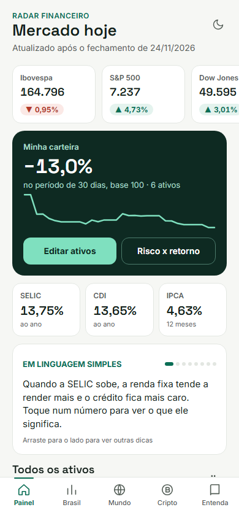
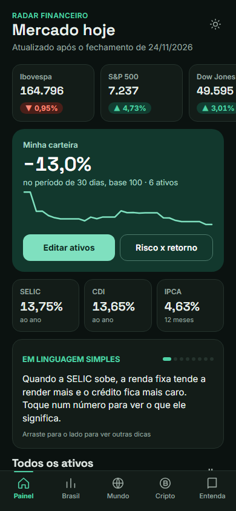
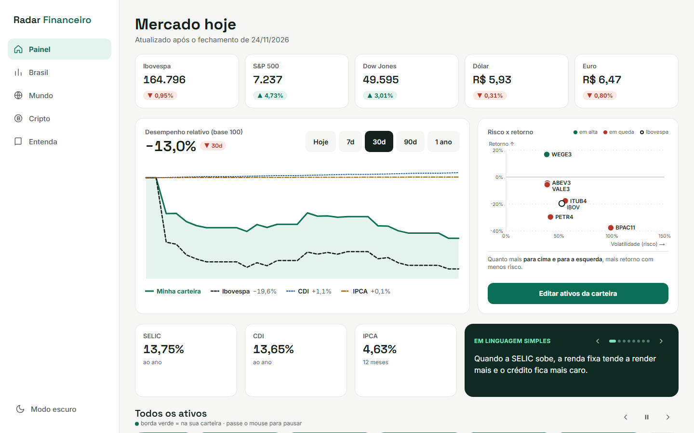
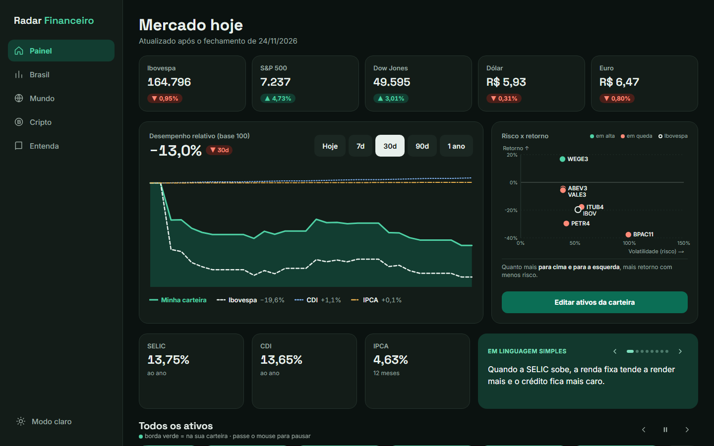
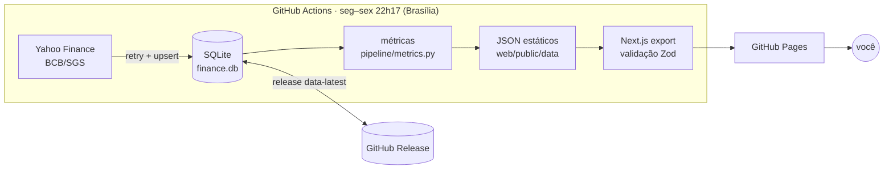

# Radar Financeiro

> Dashboard de mercado para quem está começando a investir: dados reais, linguagem simples, atualizado diariamente.

**Site:** https://samuelwvm.github.io/financial-intelligence-dashboard/ · **V1 (Streamlit):** tag [`v1-streamlit`](https://github.com/Samuelwvm/financial-intelligence-dashboard/tree/v1-streamlit)

[](https://github.com/Samuelwvm/financial-intelligence-dashboard/actions/workflows/ci.yml)
[](https://github.com/Samuelwvm/financial-intelligence-dashboard/actions/workflows/update_data.yml)

| Mobile (claro) | Mobile (escuro) |
|---|---|
|  |  |




---

## O que tem

- **Painel:** pulso do mercado (Ibovespa, S&P 500, Dow Jones, dólar e euro); sua carteira com desempenho base 100 contra o Ibovespa, o CDI e a inflação (IPCA), e gráfico de risco × retorno; SELIC, CDI e IPCA do Banco Central.
- **Brasil:** 10 ações da B3, evolução do Ibovespa e tela de cada ativo com período Hoje / 7d / 30d / 90d / 1 ano.
- **Mundo:** 10 ações globais, dólar e euro contra o real, ouro, petróleo WTI, S&P 500 e Dow Jones.
- **Cripto:** Bitcoin e Ethereum (preço, variação, máxima, mínima, volatilidade) e comparação base 100.
- **Entenda o mercado:** glossário com 25 termos, busca e filtro por categoria.
- Logos dos ativos ([Logos by AllInvestView](https://www.allinvestview.com/tools/ticker-logos/)), com iniciais quando não há logo; dicas "Em linguagem simples" que se alternam; e um carrossel automático com todos os ativos (arraste para o lado; a borda verde marca os da sua carteira).

Mobile-first, modo claro e escuro (segue o sistema, com troca manual sem "piscar"), animações com [Motion](https://motion.dev) que respeitam `prefers-reduced-motion`. Lighthouse mobile: 98–99 de performance e 100 em acessibilidade, boas práticas e SEO.

## Arquitetura



```
pipeline/            coleta, limpeza, métricas, saúde e export JSON (Python)
web/                 Next.js (App Router, export estático) + Tailwind + Motion
  app/               rotas: /, /brasil, /mundo, /cripto, /entenda, /ativo/[slug]
  components/ lib/   UI, gráficos SVG, contrato de dados (Zod), formatação pt-BR
design/mockup/       mockup da V2 (referência visual, somente leitura)
legacy/streamlit/    V1 (histórico)
docs/                auditoria da V1, decisões, hospedagem, verificação, ideias futuras
.github/workflows/   update_data.yml (dados + deploy) e ci.yml (PRs)
```

## Decisões técnicas (resumo)

- **Estático + JSON, sem servidor.** Os dados mudam uma vez por dia. Um site estático carrega na hora e não hiberna, como fariam as APIs gratuitas.
- **SQLite como fonte da verdade.** Simples e transacional, com cerca de 1 MB. Fica guardado como arquivo de uma release (`data-latest`), sem inflar o histórico do git.
- **Idempotência.** A coleta baixa a janela inteira (400 dias) e grava com upsert: rodar duas vezes dá o mesmo resultado, e dias perdidos ou preços parciais se corrigem sozinhos.
- **Métricas calculadas uma vez, no pipeline.** Um teste recalcula tudo direto no SQLite e compara com os JSON.
- **Falha visível.** Se algum ativo ficar sem dado novo, o job falha e o GitHub avisa por e-mail. Se a coleta cair, o site antigo continua no ar.

Detalhes: [docs/decisoes.md](docs/decisoes.md) · auditoria da V1: [docs/auditoria-v1.md](docs/auditoria-v1.md) · verificação: [docs/verificacao.md](docs/verificacao.md).

### Como as métricas são calculadas

Para cada ativo, com a janela em **dias corridos** contada a partir da última data disponível:

| Métrica | Fórmula |
|---|---|
| Variação do dia | `p_último / p_pregão_anterior − 1` |
| Retorno no período | `p_último / p_base − 1`, em que `p_base` é o último preço no início da janela ou antes dele |
| Base 100 | `p / p_base × 100` (o retorno do card é igual ao último ponto do gráfico − 100) |
| Volatilidade | desvio-padrão amostral dos retornos diários do período × √252 |
| Máxima / mínima | maior / menor preço do período |
| Carteira | média simples das curvas base 100 dos ativos escolhidos |
| CDI acumulado | produto, por dia útil, de `(1 + CDI anual)^(1/252)` |
| IPCA acumulado | pró-rata por dia: `(1 + IPCA do mês)^(1/dias do mês)` |

## Fontes de dados

- **Yahoo Finance** (biblioteca `yfinance`): ações, índices, câmbio, commodities e cripto. Fechamento ajustado.
- **Banco Central do Brasil, SGS:** SELIC meta (432), SELIC diária (11), CDI (4389), IPCA mensal (433) e IPCA 12 meses (13522).

Os dados são atualizados uma vez por dia útil, após o fechamento. **Não são em tempo real** e não constituem recomendação de investimento.

## Rodar localmente

Requisitos: Python 3.12+ e Node.js 22+.

```bash
git clone https://github.com/Samuelwvm/financial-intelligence-dashboard.git
cd financial-intelligence-dashboard

# 1) dados
python -m venv .venv
source .venv/bin/activate          # Windows: .venv\Scripts\activate
pip install -r pipeline/requirements-dev.txt
python -m pipeline.run --no-health  # coleta ~400 dias e gera web/public/data/*.json

# 2) site
cd web
npm ci
npm run dev                        # http://localhost:3000
```

Testes: `python -m pytest pipeline` · `cd web && npm run lint && npm run typecheck && npm test && npm run build && npm run test:e2e`.

## Hospedagem

GitHub Pages, publicado pelo próprio workflow diário. Passo a passo, alternativas e como reverter: [docs/hospedagem.md](docs/hospedagem.md).

## V1

A primeira versão (Streamlit + Plotly) está preservada e executável na tag [`v1-streamlit`](https://github.com/Samuelwvm/financial-intelligence-dashboard/tree/v1-streamlit) e na branch [`v1-streamlit-archive`](https://github.com/Samuelwvm/financial-intelligence-dashboard/tree/v1-streamlit-archive).

---

Feito por [Samuel](https://github.com/Samuelwvm). Os cálculos são automáticos, baseados em dados públicos, e não representam análise de valores mobiliários nem recomendação de investimento. Rentabilidade passada não garante retorno futuro.
